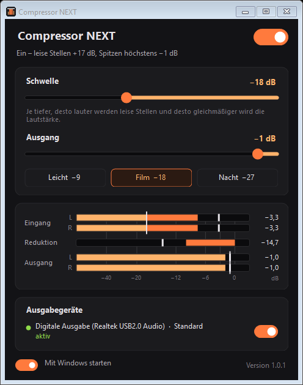
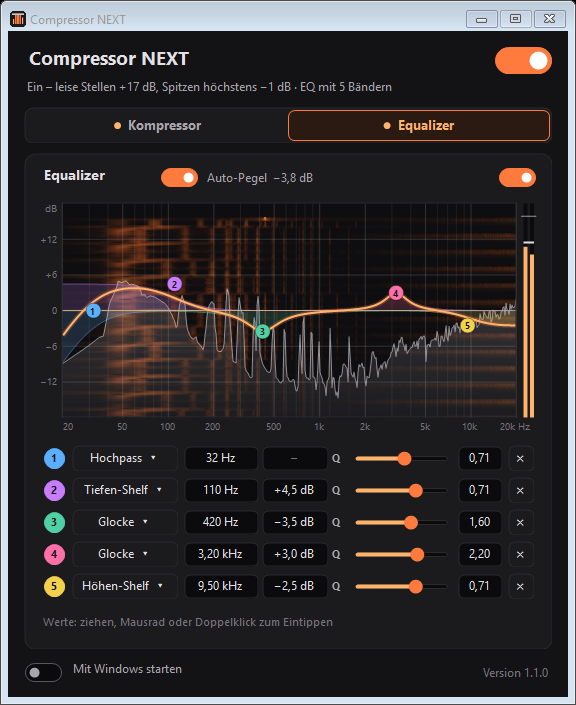

# Compressor NEXT

**Compressor NEXT** gleicht die Lautstärke von Filmen, Serien und Videos unter Windows aus: Leise Gespräche werden
lauter, laute Musik und Effekte werden abgefangen. Es arbeitet für **alle Programme und alle Ausgabegeräte** und sitzt
in der Windows-Tonkette **vor dem Lautstärkeregler** – der Regler bestimmt also weiterhin, wie laut es insgesamt ist.
Hinter dem Kompressor sitzt ein **parametrischer Equalizer** mit Spektrum und Spektrogramm des Ausgangs.

**Download:** Setup unter [Releases](https://github.com/ShakieVan/Compressor-NEXT/releases/latest)
(Windows 10 ab 1809 oder Windows 11, 64 Bit).

Technisch ist es ein Lautheits-Maximierer nach Art von [LoudMax](https://loudmax.blogspot.com/): ein vorausschauender
Brickwall-Limiter. Die Mathematik stammt 1:1 aus [Player NEXT](https://github.com/ShakieVan/Player-NEXT) (dort
`LoudnessMaximizer`). LoudMax selbst ist nicht enthalten – sein Autor erlaubt keine Weitergabe ohne Genehmigung.

> Compressor NEXT ist ein privates Projekt und steht in keiner Verbindung zu LoudMax oder dessen Autor. Es greift in
> die Windows-Tonkette ein (eigenes Audio-Modul im Windows-Audiodienst, Einträge je Ausgabegerät); die Deinstallation
> nimmt alles zurück. Benutzung auf eigene Gefahr.

| Kompressor | Equalizer |
|---|---|
|  |  |

## Installieren

`CompressorNext-Setup-1.1.0.exe` ausführen. Das Setup

1. kopiert die Dateien nach `C:\Program Files\Compressor NEXT`,
2. meldet das Audio-Modul bei Windows an und hängt es in alle bekannten Ausgabegeräte ein,
3. startet den Windows-Audiodienst neu (**der Ton setzt dabei ein, zwei Sekunden aus**; manche Programme muss man
   danach neu starten, damit sie wieder Ton haben),
4. richtet den Dienst „Compressor NEXT“ ein, der neue Ausgabegeräte künftig automatisch einbindet,
5. startet die Bedienoberfläche und trägt sie in den Autostart ein.

Fehlt die .NET 10 Desktop Runtime, lädt das Setup sie von Microsoft herunter (die Signatur wird vorher geprüft). Weil
das Setup nicht signiert ist, warnt Windows SmartScreen eventuell: „Weitere Informationen“ → „Trotzdem ausführen“.

## Bedienen

Compressor NEXT läuft als Symbol im Infobereich der Taskleiste. Ein Klick öffnet das Fenster, ein Rechtsklick das Menü
(Ein/Aus, Kompressor, Equalizer, Voreinstellungen, Beenden).

Der **Hauptschalter** oben schaltet Kompressor und Equalizer zusammen: Aus = der Ton läuft unverändert durch (bitgenau,
nur 1,5 ms verzögert). Darunter liegen zwei Reiter, jeder mit eigenem Schalter; der Punkt im Reiter zeigt, ob dieser
Teil gerade arbeitet (ein roter Punkt beim Kompressor heißt: ein Gerät braucht „Beheben“).

### Kompressor

| Regler | Bedeutung |
|---|---|
| **Ein/Aus** | Nur der Kompressor; der Equalizer arbeitet weiter. |
| **Schwelle** (0 bis −30 dB) | Spitzen darüber werden abgefangen. Je tiefer, desto lauter werden leise Stellen und desto gleichmäßiger wird die Lautstärke. |
| **Ausgang** (0 bis −12 dB) | Höchster Pegel am Ausgang. Leise Stellen werden um *Ausgang − Schwelle* lauter (Schwelle −18, Ausgang −1: 17 dB). |
| **Leicht / Film / Nacht** | Voreinstellungen für die Schwelle: −9, −18, −27 dB. |

Weil leise Stellen deutlich lauter werden, dreht man nach dem Einschalten die Windows-Lautstärke entsprechend zurück.

Die **Pegelanzeige** zeigt wie bei LoudMax den Eingang (links/rechts), die Reduktion und den Ausgang (hinter dem
Equalizer, also das, was wirklich hinausgeht). Der weiße Strich auf dem Eingang ist die Schwelle, der auf dem Ausgang
der Ausgangspegel. Steht dort „Kein Signal“, obwohl Ton läuft, arbeitet Compressor NEXT auf diesem Gerät nicht (siehe
unten).

Unter **Ausgabegeräte** stehen die angeschlossenen Geräte mit ihrem Zustand:

- **aktiv** – es läuft Ton über Compressor NEXT
- **bereit** – eingebunden, gerade kein Ton
- **ausgenommen** – mit dem Schalter rechts für dieses Gerät abgeschaltet
- **nicht eingebunden** / **Windows-Audioverbesserungen aus** – „Beheben“ richtet das ein (Adminrechte, der Ton setzt
  kurz aus)

### Equalizer

Die Grafik reicht von 20 Hz bis 20 kHz: jedes Band als farbige Fläche, darüber die Gesamtkurve (orange). Dahinter läuft
das Spektrum dessen, was gerade hinausgeht – als helle Fläche und als Spektrogramm, das nach oben wegläuft (etwa die
letzten acht Sekunden). Der schmale Balken rechts ist der Ausgangspegel; rot heißt übersteuert.

| Bedienung in der Grafik | Wirkung |
|---|---|
| Doppelklick ins Leere | neues Band (Glocke) an dieser Stelle, höchstens fünf |
| Punkt ziehen | Frequenz (waagerecht) und Verstärkung (senkrecht); mit Umschalt fein |
| Mausrad auf einem Punkt | Güte (Schärfe): größer = schmaler |
| Doppelklick auf einen Punkt | Verstärkung zurück auf 0 dB |
| Rechtsklick | Typ wählen, Band vorübergehend aus, entfernen; im Leeren ein Band eines bestimmten Typs hinzufügen |
| Entf, Pfeiltasten, Bild auf/ab | gewähltes Band entfernen, verschieben, Güte ändern |

Die Liste unter der Grafik hat nur Zeilen für vorhandene Bänder: Nummer (Klick schaltet das Band aus und an), Typ,
Frequenz, Verstärkung, Güte als Schieber und als Zahl, × entfernt es. Die Zahlenfelder lassen sich senkrecht ziehen,
mit dem Mausrad verstellen oder per Doppelklick eintippen (z. B. `1,2k` oder `-4,5`).

Typen: **Glocke**; **Tiefen-** und **Höhen-Shelf** heben oder senken alles unter- bzw. oberhalb der Frequenz;
**Hochpass** und **Tiefpass** schneiden Tiefen bzw. Höhen ab (12 dB/Oktave); **Kerbe** entfernt eine schmale Frequenz,
etwa Brummen bei 50 Hz.

**Auto-Pegel** (an): Der Kompressor hält die Spitzen unter „Ausgang“. Hebt der Equalizer dahinter etwas an, gingen sie
darüber hinaus und es verzerrte. Auto-Pegel senkt deshalb den Pegel hinter dem Equalizer um die stärkste Anhebung der
Kurve (bei +3 dB um 3 dB). Der Klang bleibt derselbe, nur insgesamt etwas leiser; Absenkungen brauchen keinen Ausgleich.

### Befehlszeile

Z. B. für eine Tastenkombination: `CompressorNext.exe --set enabled=toggle` (alles), `--set compressor=toggle`,
`--set eq=toggle` oder `--set threshold=-24 output=-1`.

## Wo es nicht wirken kann

- **Bitstream/Passthrough** (Dolby Digital, DTS, Atmos unverändert an einen AV-Receiver): Der Ton ist dann kein PCM;
  Windows kann ihn nicht bearbeiten. Im Player auf PCM-Ausgabe stellen.
- **Exklusiver Modus** (WASAPI exclusive, ASIO): Diese Programme umgehen die Windows-Tonkette absichtlich.
- **Treiber mit Modul-Listen, deren Module nicht ladbar sind:** Manche Treiber (z. B. „Realtek(R) Audio“) geben
  Listen von Herstellermodulen vor. Kann Windows auch nur ein Mitglied einer Liste nicht erzeugen, verwirft es die
  ganze Liste – dann lädt es auch Compressor NEXT nicht, egal an welcher Stelle der Liste es steht (hier mit einem
  absichtlich nicht vorhandenen Modul nachgestellt). So war es auf einem Rechner mit Realtek-Treiber: Die
  Realtek-Module wurden dort schon im Auslieferungszustand nicht geladen. Die Einrichtung merkt das bei ihrer Prüfung
  und setzt auf solchen Geräten Compressor NEXT **anstelle** der Stream-Liste des Herstellers; dessen Modus- und
  Endpunkt-Listen bleiben unberührt. Verloren geht dadurch nur etwas, wenn die Herstellermodule vorher wirklich
  gearbeitet haben. Die Deinstallation stellt den Ursprungszustand wieder her.
  Sind die Herstellermodule ladbar, reiht sich Compressor NEXT einfach in die Liste ein (mit Microsoft-Modulen als
  Partner geprüft).
- **Einzel-Eintrag neben einer Liste:** Stehen für denselben Platz ein Einzel-Eintrag und eine Liste, nimmt Windows
  den Einzel-Eintrag und übergeht die Liste. Die Einrichtung erkennt auch das an ihrer Prüfung und weicht aus.
- **Nach einem Treiber-Update** setzt Windows die Effekt-Einträge eines Geräts manchmal zurück. Der Dienst bemerkt das
  und bindet das Gerät wieder ein; dabei startet er den Audiodienst neu (höchstens dreimal pro Stunde).

## Wie es funktioniert

```
Programm ─► Windows-Audio-Engine ─► [Compressor NEXT: Kompressor ─► Equalizer] ─► Lautstärkeregler ─► Gerät
```

| Teil | Aufgabe |
|---|---|
| `CompressorNextApo.dll` | Audio-Modul (APO). Windows lädt es in den Audiodienst (`audiodg.exe`) und reicht jeden Audioblock hindurch. Enthält Maximierer und Equalizer. |
| `CompressorNextSvc.exe` | Einrichtung (`install`, `repair`, `detach`, `uninstall`, `status`) und Dienst, der neue Ausgabegeräte einbindet. Nimmt keine Eingaben entgegen. |
| `CompressorNext.exe` | Bedienoberfläche im Infobereich. Läuft ohne Adminrechte. |
| `%ProgramData%\CompressorNext\state.bin` | Gemeinsamer Zustand (256 KB): Die Oberfläche schreibt die Einstellungen hinein, das Audio-Modul liest sie bei jedem Audioblock und meldet Pegel und Spektrum zurück. Eine Datei von 1.0 wird beim Update nur verlängert; die Einstellungen bleiben. |

**Maximierer:** benötigte Verstärkung → Minimum über 1,5 ms → sofortiger Angriff, 120 ms Rückkehr → gleitender
Mittelwert über 1,5 ms; das Audio läuft 1,5 ms verzögert. Minimum und Mittelwert gleicher Länge garantieren, dass an
der verzögerten Spitze nie mehr Verstärkung anliegt, als sie verträgt. Alle Kanäle (auch 5.1/7.1) teilen eine
Verstärkung. Schwelle, Ausgang und Ein/Aus werden über 20 ms überblendet, damit nichts knackt.

**Equalizer:** acht Plätze in der Zustandsdatei (die Oberfläche bietet fünf an) mit Biquad-Filtern nach dem
RBJ-Kochbuch – dieselben Formeln wie im Equalizer von Player NEXT (`Biquad.kt`), doppelt genau gerechnet, damit auch
tiefe Frequenzen sauber bleiben. Frequenz, Verstärkung und Güte gleiten (30 ms); neue oder entfernte Bänder und
Typwechsel werden über 20 ms überblendet. Beim Ziehen eines Bandes bleibt der Rest unter −75 dBFS, es knackt also
nichts. Ohne aktives Band ist der Equalizer bitgenau aus. Die Grafik rechnet mit denselben Formeln und der Abtastrate
des laufenden Audiostroms, zeigt also genau, was man hört.

**Spektrum:** Nur solange der Reiter Equalizer offen ist, schreibt das Audio-Modul den Ausgang (Mittel aller Kanäle) in
einen Ringpuffer der Zustandsdatei; sonst kostet es nichts. Die Oberfläche rechnet daraus 30-mal pro Sekunde eine FFT
(8192 Punkte bei 44,1/48 kHz, Hann-Fenster) und neigt sie um 3 dB/Oktave, sodass rosa Rauschen waagerecht erscheint.

**Einbinden:** Windows liest pro Ausgabegerät aus der Registry
(`HKLM\SOFTWARE\Microsoft\Windows\CurrentVersion\MMDevices\Audio\Render\{Gerät}\FxProperties`), welche Effekt-Module es
lädt. Compressor NEXT trägt sich in den ersten freien Platz ein – bevorzugt als Stream-Effekt, sonst als Modus- oder
Endpunkt-Effekt; alle liegen vor dem Lautstärkeregler des Geräts. Gibt der Treiber Listen von Herstellermodulen vor
(z. B. Realtek), reiht es sich dort ein. Jede Änderung wird mit dem Ursprungswert unter
`HKLM\SOFTWARE\ShakieVan\CompressorNext` vermerkt und bei der Deinstallation zurückgenommen.

**Prüfen:** Einrichtung und „Beheben“ verlassen sich nicht auf den Eintrag allein. Auf jedem aktiven Gerät spielen sie
kurz Stille ab und sehen nach, ob der Ton wirklich durch das Modul läuft. Lädt Windows das Modul an einem Platz nicht,
kommt der nächste dran (hinten in der Liste → vorn → Endpunkt-Liste → Modus-Liste); erst als letztes Mittel ersetzt es
das Stream-Modul des Herstellers. Welcher Platz gewählt wurde, steht im Protokoll und in `CompressorNextSvc.exe status`.
Wie bei Equalizer APO wird `DisableProtectedAudioDG=1` gesetzt, damit Windows das unsignierte Modul lädt (auch das
nimmt die Deinstallation zurück).

**Sicherheit:** Das Audio-Modul fängt eigene Fehler ab und reicht den Ton dann unverändert durch; fehlt die
Zustandsdatei, tut es ebenfalls nichts. `CompressorNextSvc.exe status` zeigt ohne Adminrechte, was eingebunden ist.
Das Protokoll von Einrichtung und Dienst liegt in `C:\Program Files\Compressor NEXT\service.log`.

**Wenn es auf einem Rechner nicht wirkt:** `CompressorNext-Diagnose.cmd` (liegt neben dem Setup in `dist`) doppelklicken.
Es liest nur aus, braucht keine Adminrechte, spielt einen kurzen leisen Testton und legt den Bericht
`CompressorNext-Diagnose.txt` auf den Desktop. Darin steht unter anderem, ob Windows das Modul lädt, welche
Effekt-Einträge das aktive Gerät hat und ob der Testton durch das Modul gelaufen ist. Am Ende steht das Spurprotokoll
des Moduls: was Windows von ihm verlangt hat und mit welchem Ergebnis.

Für die Entwicklung: `CompressorNextSvc.exe probe` (Adminrechte) probiert auf allen aktiven Geräten jeden Effektplatz
einzeln durch und schreibt nach `service.log`, welche funktionieren. `probe {CLSID}` stellt zusätzlich einen Treiber
nach, der ein eigenes Stream-Modul mitbringt; `probe lists` testet Listen-Kombinationen; `probe vendor` untersucht ein
Gerät, dessen Treiber eine Stream-Liste vorgibt (sechs Kombinationen, jeweils mit den im Audiodienst geladenen
Effekt-DLLs), und stellt danach den funktionierenden Zustand wieder her. `CompressorNext-Untersuchung.cmd` führt
`probe vendor` samt Diagnose mit einem Doppelklick aus.

## Deinstallieren

Über „Apps“ in den Windows-Einstellungen. Die Deinstallation hängt das Modul überall aus, stellt die ursprünglichen
Einträge wieder her, entfernt den Dienst und startet den Audiodienst neu.

## Lizenz

Compressor NEXT darf für **nicht-kommerzielle Zwecke** frei genutzt, verändert und weitergegeben werden – privat, zum
Lernen und Ausprobieren, in gemeinnützigen Organisationen, Bildungseinrichtungen und Behörden. Es gilt die
[PolyForm Noncommercial License 1.0.0](LICENSE.md). Wer es weitergibt, gibt die Lizenz und den Urheberhinweis mit.
Kommerzielle Nutzung ist damit nicht erlaubt; dafür bitte nachfragen.

Das Programm kommt ohne Gewähr.

## Bauen

Voraussetzungen: Visual Studio 2022 (C++-Arbeitslast mit CMake, Windows SDK), .NET 10 SDK, Inno Setup 6.

```powershell
.\build.ps1
```

Das Skript baut das native Modul, lässt die Tests laufen (`maximizer_test` – darunter die vier Tests aus Player NEXT –,
`equalizer_test` mit Frequenzgang, Knackfreiheit und Stabilität, und `apo_host_test`, das das Modul so aufruft wie die
Windows-Audio-Engine), baut die Oberfläche und erzeugt `dist\CompressorNext-Setup-<Version>.exe`.

| Ordner | Inhalt |
|---|---|
| `src/native/dsp` | Maximierer (`Maximizer.h`), Equalizer (`Equalizer.h`) |
| `src/native/apo` | Audio-Modul |
| `src/native/svc` | Hilfsprogramm und Dienst |
| `src/native/shared` | Aufbau der Zustandsdatei (identisch in `src/CompressorNext/SharedState.cs`) |
| `src/native/tests` | Tests |
| `src/CompressorNext` | Bedienoberfläche (WinForms, .NET 10) |
| `installer` | Inno-Setup-Skript |
